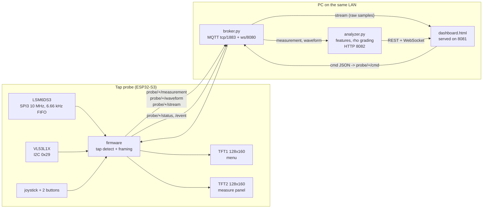

# The Tap Probe

A handheld **tap-test probe** that assists a surveyor in finding *debonded* ("hollow") patches in
external wall finishes, plus the whole system around it: ESP32-S3 firmware with a joystick UI on two
small TFTs, MQTT telemetry, a Python analysis backend, and a browser dashboard that does the grading.


---

## 中文简介

香港旧楼外墙饰面（批荡、瓷砖、石材）剥落是常见的高空坠物风险，传统检测靠检测员拿锤子敲墙、听声音
判断空鼓——主观、不可复现、也没有记录。本项目把这套动作做成仪器：

- **探头端**：ESP32-S3 + LSM6DS3 加速度计（SPI，6.66 kHz 硬件 FIFO）+ VL53L1X 测距 + 双 TFT 屏 +
  摇杆菜单。敲一下墙，探头抓 1024 点加速度波形，经 MQTT 发出去。
- **分析端**：Python 后端订阅波形，做频域特征提取（峰值频率、频谱重心、高低频能量比、衰减时间常数、
  峰度……），按**网格测点之间的相对差异**分级（G0 未见脱粘 / G1 待复测 / G2 指示脱粘），而不是拿一个
  绝对阈值套所有墙。
- **网页端**：实时瀑布图、原始波形、网格测量板、分级卡片，数据落盘可跨重启保留。
- **部署**：一条 `start.bat` 起全套（broker + 后端 + 网页），依赖轮子随包分发，新电脑离线也能装。

诚实说明：**这一版没有真实标定样本**，分级阈值是占位值；报告文档（设计阶段，48 kHz 麦克风方案）与
实际实现（6.66 kHz 加速度方案）不是同一套传感通道，两者的结论不能互相套用。详见文末「已知限制」。

---

## What the instrument does

A surveyor taps a wall with a hammer and listens: a *debonded* patch of render or tiling rings **longer
and lower** than a well-bonded area, which gives a short, high-pitched click. The probe replaces the ear
with an accelerometer and the judgement with a spectrum:

1. The operator presses the probe tip against the wall and taps it.
2. The accelerometer runs at **6.66 kHz** out of its hardware FIFO; a tap is detected as a deviation
   from the tracked gravity baseline, and a **1024-sample window** (≈154 ms, with ~19 ms of
   pre-trigger history) is published over MQTT.
3. The PC backend re-computes spectral features from the raw waveform, keeps a per-point table, and
   grades each point **relative to the other points on the same panel**.
4. The browser shows the live spectrum, the waveform, the grid plan and the grading table.

The point of the relative scheme: the probe's own resonances, the operator's hand and the contact patch
are common to every measurement, so comparing points on the *same* panel with the *same* probe cancels
them. What is left is the panel.

---

## System architecture



Two independent paths on purpose: the browser subscribes **directly** to the broker over WebSocket for
raw samples (waterfall, live acceleration), while the backend owns the feature maths and the grading.
Neither depends on the other being up.

---

## Hardware

### Bill of materials (as built)

| Item | Part | Notes |
| --- | --- | --- |
| MCU board | ESP32-S3-DevKitC-1 (N8, 8 MB flash, no PSRAM) | native USB-Serial/JTAG on `COM4` |
| Accelerometer | LSM6DS3 module (WHO_AM_I `0x69`) | SPI3 at 10 MHz, **FIFO is essential** — see below |
| Range finder | VL53L1X | I2C or SPI; here I2C at `0x29` |
| Displays | 2 × ST7735-class 128×160 SPI TFT | menu + measure panel |
| Input | 2-axis joystick module + push button | menu navigation |
| Power | 5 V USB | the probe is USB-tethered in this revision |

The design document's **12 V solenoid striker is not driven by this firmware image**. `app_main.c`
still contains the striker driver from the design stage, but the built target only compiles
`hardware_bringup.c` and `probe_menu.c`, so in the current revision the tap is delivered by hand.

### Pin map

| Function | GPIO | Function | GPIO |
| --- | --- | --- | --- |
| IMU SCLK | 1 | TFT shared SCLK | 13 |
| IMU MOSI | 2 | TFT shared MOSI | 14 |
| IMU MISO | 4 | TFT shared MISO | 15 |
| IMU CS | 5 | TFT1 CS / DC / RST | 16 / 17 / 18 |
| I2C SDA (VL53L1X) | 8 | TFT2 CS / DC / RST | 21 / 47 / 6 |
| I2C SCL | 9 | Joystick X / Y (ADC) | 10 / 11 |
| RGB LED (onboard) | 48 | Joystick button | 46 |
| — | — | Solenoid (legacy) / trigger (reserved) | 7 / 12 |

Everything above mirrors `05_firmware/main/probe_config.h`, which is the single source of truth for
pins and timing.

### Why SPI, and why the FIFO matters

I2C at 400 kHz cannot carry 6.66 kHz: one sample set is 6 data bytes = 54 bus bits ≈ 135 µs against a
150 µs sample period, i.e. ~90 % of the bus before any addressing overhead. SPI at 10 MHz moves the
same set in ~6 µs, so the accelerometer lives on SPI and I2C is left to the range finder.

The 4096-word FIFO holds **1365 sample sets ≈ 205 ms**, so the capture task drains it every 20 ms
(~133 sets, one 1.6 kB burst) instead of polling the output registers. Register `FIFO_CTRL3`
(`0x08`) must be `001` — *accelerometer, no decimation* — or the FIFO returns zeros; and
`FIFO_CTRL5` ODR code 10 is 6.66 kHz (code 9 is only 3.33 kHz). Both mistakes are easy to make and
both were made here before the captures stopped being empty.

---

## Firmware

Built with **PlatformIO 6.2.0** against **ESP-IDF 6.1.0** (`xtensa-esp-elf-gcc 15.2`), C99.

```bash
cd 05_firmware
pio run -e esp32s3_bringup                 # build
pio run -e esp32s3_bringup -t upload       # flash over USB-Serial/JTAG
```

The image is 1 045 277 bytes, so it uses a 1.5 MB factory partition (`partitions_large.csv`);
flash usage is ~67 %. The build prints a flash-size mismatch warning because the framework default in
the image header is 2 MB while the module is 8 MB — harmless here, the app fits in either.

> On a fresh machine, Point PlatformIO at its own core directory if yours is not on `C:`.

### UI: two screens, one job each

| Screen | Shows |
| --- | --- |
| **TFT1 — menu** | pages `WIFI LINK`, `MQTT LINK`, `SENSORS`, `TAP DATA`, `SYSTEM`: AP scan and join, passcode, auto-join, broker URI, publish/tap-stream/QoS toggles, zero baseline, send-now, clear counter, device id, restart link, reboot |
| **TFT2 — measure panel** | the **operating logic**, not a second opinion: `DISTANCE` from the range finder, `LAST TAP` peak in g, tap count, a tiny grid badge showing *which cell the next tap lands in*, and WIFI / MQTT / TAP STREAM link dots |

Screens: [menu](05_firmware/docs/screens/01_main.png) ·
[WiFi](05_firmware/docs/screens/02_wifi.png) ·
[MQTT](05_firmware/docs/screens/03_mqtt.png) ·
[editor](05_firmware/docs/screens/06_editor.png) ·
[measure panel](05_firmware/docs/screens/07_measure_panel.png) ·
[data](05_firmware/docs/screens/08_data.png)

No verdict is computed on the device. A second, differently-computed opinion on a 1.8" panel would
only be a second thing to disagree with the dashboard.

### Settings survive a power cycle

Broker URI, device id, WiFi credentials and the grid shape are written to NVS (namespace
`probe_cfg`). A board carried to another PC needs the broker address typed **once** from the joystick
menu; after that it comes up configured. Compile-time defaults live in `probe_config.h`.

**Credentials are not in this repository.** `PROBE_WIFI_SSID_DEFAULT` / `..._PASS_DEFAULT` are
placeholders; a local build can drop a git-ignored `05_firmware/main/probe_secrets.h`:

```c
#define PROBE_SECRETS_SSID "my-ssid"
#define PROBE_SECRETS_PASS "my-password"
```

---

## MQTT protocol

Everything is JSON on `probe/<dev>/...`, broker default `mqtt://192.168.3.12:1883` (editable on the
device). Full reference: [PROTOCOL.md](05_firmware/tools/mqtt_demo/PROTOCOL.md).

| Topic | Direction | Payload |
| --- | --- | --- |
| `probe/<dev>/measurement` | device → | `{"dev":"probe-01","pt":"P0","n":42,"t1":[0.012,-0.004,1.002],"rms1":0.0312,"pk1":0.4421,"rssi":-58}` |
| `probe/<dev>/waveform` | device → | `{"dev","pt","seq","tap","fs":6660,"n":1024,"scale":8192,"pre":128,"trig":2062,"pkg":0.252,"d":"<base64 int16 xyz>"}` |
| `probe/<dev>/stream` | device → | `{"dev","pt","seq","fs":6660,"n":148,"d":"<base64 int16 xyz>"}` — one batch per 20 ms FIFO drain |
| `probe/<dev>/status` | device → | retained `online` / `offline` (LWT) |
| `probe/<dev>/event` | device → | acks: `{"dev","ev","cmd","ok",...}` |
| `probe/<dev>/cmd` | → device | `{"cmd":"publish|stream|wave_stream|reboot|devid|thresh|scan|point|grid|zero", ...}` |

`d` is little-endian `int16` xyz triples; `scale` is LSB per g (8192 at ±4 g). The tap window is
published at QoS 0, and the continuous stream is explicitly **opt-in** (`{"cmd":"wave_stream","on":true}`)
because it is ~54 kB/s of sample data.

---

## Analysis backend

`05_firmware/tools/mqtt_demo/analyzer.py` (stdlib + `paho-mqtt` + `numpy`) subscribes to the broker,
and for every waveform calls `06_analyze_tap.py::extract_features_from_waveform` — the same function the
offline report pipeline uses, so the dashboard cannot silently drift from the documented maths:

| Feature | Meaning |
| --- | --- |
| `f_peak_hz`, `f_centroid_hz` | where the energy sits |
| `band_ratio_lh` | energy below the crossover ÷ energy above it, default band **30–1000 Hz**, crossover **300 Hz** |
| `decay_tau_ms` | ring-down time constant from a log-envelope fit |
| `peak_g`, `rms_g`, `crest_factor`, `kurtosis` | amplitude and impulsiveness |

The band is clamped to **0.45·fs** at run time (Nyquist guard), and is adjustable through
`POST /api/config`.

### Grading is relative, not absolute

`rho = band_ratio_lh(point) / band_ratio_lh(reference)` across the points of one panel. Three modes:

| Mode | Rule |
| --- | --- |
| `group` (default) | rank the comparable points by `rho` and cut at quantiles: lower third → G2 (debond indicated), middle → G1 (re-test), upper third → G0 |
| `rank` | order-only, with an explicit verdict sentence |
| `threshold` | `rho ≥ 0.80` → G0, `0.50 ≤ rho < 0.80` → G1, `rho < 0.50` → G2 — **placeholder values**, see limitations |

Every point gets a bootstrap 5–95 % interval on `rho`; points whose contact-quality gate fails are
flagged rather than silently graded. The browser owns the `rows × cols` grid and sends a flat index
`idx = row·cols + col`; the device only remembers the shape, so the menu, the TFT2 badge and the page
always agree.

### HTTP API (port 8082)

`/api/health`, `/api/latest`, `/api/history`, `/api/stats`, `/api/points`, `/api/grid`,
`/api/point`, `/api/config`, `/api/reference`, `/api/reset`, `/api/cmd`, plus a WebSocket
`/api/stream` that pushes the point table. Sessions persist to `.session/taps.jsonl` and survive a
restart.

---

## Dashboard

`dashboard.html` — one page, no build step, no CDN (`mqtt.min.js` is vendored):

| Card | What it shows |
| --- | --- |
| 相对分级（双面差分测量） | `rho` per point with confidence bars, grade chips, verdict sentence, threshold controls |
| 单次敲击（绝对判定，仅参考） | the absolute `band_ratio` rule, labelled as reference only |
| 最近一次敲击特征 | the eight features of the last tap |
| 重复性 CV%（窗口内） | repeatability of each feature within a point |
| 加速度模值（原始流 8080） | live |a| from the raw MQTT-over-WebSocket stream |
| 最近一次敲击波形摘要 | peak, RMS, rise time, decay to 15 % |
| 最近敲击时间线 | tap-by-tap log |
| 网格测量 | `rows × cols` plan, per-cell tap counts and grades — click a cell to switch the device point |
| 实时瀑布图（6.66 kHz 连续流） | 512-point Hann STFT, hop 128, 0–3000 Hz, scrolling in time |
| 高精度原始波形（1024 点） | the full tap window, |a| / X / Y / Z, raw · min-max · RMS |
| 原始 JSON（MQTT 测量帧） | the last frame verbatim, for debugging the link |

---

## Deployment

`tap_probe_deploy/` is a self-contained copy of the PC side: broker, analyzer, page, simulator and an
**offline wheel cache**, behind one launcher.

```bat
copy tap_probe_deploy  D:\somewhere\tap_probe_deploy
double-click start.bat        rem installs deps, starts 1883/8080/8081/8082, opens the browser
```

Then on the probe: **MQTT LINK → BROKER** → `mqtt://<this-PC-IP>:1883` (the launcher prints the exact
string). Full walkthrough, ports, firewall rules and troubleshooting: [README.md](tap_probe_deploy/README.md).

| Port | Use |
| --- | --- |
| 1883 TCP | MQTT broker — probe publishes, analyzer subscribes |
| 8080 WebSocket | MQTT-over-WS — the browser takes the raw stream directly |
| 8081 HTTP | the dashboard and its assets |
| 8082 HTTP/WS | analyzer API and point stream |

No board? `python simulator.py --mode alternate` publishes synthetic taps as `sim-01` so the whole
page can be exercised without hardware.

---

## Repository layout

| Path | What it is |
| --- | --- |
| `05_firmware/` | ESP-IDF / PlatformIO project — `main/hardware_bringup.c`, `main/probe_menu.c`, `main/probe_config.h` |
| `05_firmware/tools/mqtt_demo/` | analysis backend, broker, dashboard, simulator, protocol + verification docs |
| `05_firmware/docs/screens/` | rendered UI mock-ups of every screen |
| `tap_probe_deploy/` | portable PC-side bundle (see above) |
| `06_analyze_tap.py` | offline analysis pipeline: feature extraction, integrity gates, tables, figures |
| `results/` | output of `06_analyze_tap.py` — **synthetic demonstration data**, clearly stamped |
| `EEE4483_MiniProject_Report.md` | the assembled report (design-time document) |
| `00_main_report.md`, `_chapters/`, `03_wsss_standards.md` | report sources, assembled by `build_report.sh` |
| `_repro/` | scripts that computed specific report numbers |

### Building the report

```bash
bash build_report.sh          # writes EEE4483_MiniProject_Report.md from the chapter sources
python 06_analyze_tap.py --demo --outdir results     # regenerate the demonstration tables/figures
```

Submission checklist (author fields, `[TO VERIFY]` items, the honesty constraints on §8):
[SUBMISSION_NOTES.md](SUBMISSION_NOTES.md).

---

## Known limitations (read before quoting any number)

This is a working instrument, not a validated survey device. In order of how much they matter:

1. **No ground truth yet.** No bonded/debonded reference panel has been measured against a known
   state, so every threshold in the system is a placeholder. A tile with a 5 mm foam backing is the
   cheapest one-off calibration target that would change this.
2. **The report and the implementation use different sensing channels.** The design document reasons
   about a **48 kHz microphone** and a 300 Hz–15 kHz band; the built probe uses an accelerometer at
   **6.66 kHz** with a 30–1000 Hz analysis band. The report's `band_ratio_lh` prior ("bonded high,
   debonded low") was derived for the microphone band and does **not** transfer to the accelerometer
   band — measured values sit on the other side of 1. Treat the direction as uncalibrated.
3. **Energy is concentrated below 600 Hz** in the measured response, so the accelerometer's usable
   band is narrow; the 1.2–2.9 kHz octave carries only a couple of percent and is not repeatable
   (CV ≈ 30 %). Any method that relies on high-frequency energy (e.g. a low/high "R_low" contrast)
   has no discriminating power at this bandwidth.
4. **`decay_tau` is dominated by the hand and the probe**, not the panel (`tau` ≈ 100 ms against the
   ~20 ms of a tap window's first ring-down). Read it as relative, never as a material property.
5. **Same-point spectral similarity is 0.95 within 30–1000 Hz but 0.79 across 100–2900 Hz**, so a
   "repeatability ≥ 0.90" acceptance rule is only valid band-limited.
6. **The continuous stream is QoS 0.** Measured throughput was ~5700 samples/s against a nominal
   6660 (~14 % short) — fine for a waterfall view, not for a loss-free recording.
7. **`results/` is synthetic.** It is stamped as such in every table and figure; do not cite it as a
   measurement.
8. **The range finder cannot measure wall size.** VL53L1X is a single-point sensor; the grid plan
   (`rows × cols`) comes from the operator in the browser, not from the hardware.

### Documents and their vintage

| Document | Covers | Status |
| --- | --- | --- |
| [PROTOCOL.md](05_firmware/tools/mqtt_demo/PROTOCOL.md) | topics, payloads, API | mostly current; older sections still describe the 2.6 kHz polled era |
| [verify.md](05_firmware/tools/mqtt_demo/verify.md) | end-to-end verification log with real outputs | current for the grading/API work, predates grid + waterfall |
| [FIRMWARE.md](05_firmware/tools/mqtt_demo/FIRMWARE.md) | firmware ↔ analysis hand-off | current |
| [05_firmware/README.md](05_firmware/README.md) | Appendix A of the report | **design-stage**, describes the microphone/I2S path |

---

## Roadmap

- [ ] One-off calibrated reference panel (bonded vs 5 mm foam) → real `rho` distribution → real thresholds
- [ ] Re-derive the analysis band for the accelerometer (the 30–1000 Hz default predates the SPI work)
- [ ] Stream at QoS 1, or on-device decimation, to remove the ~14 % sample loss
- [ ] Four VL53L1X modules for reverse positioning, so the grid can be laid out automatically
- [ ] On-device features (the ESP32-S3 has the headroom; the FFT is the only real cost)
- [ ] Battery + enclosure, so the probe is untethered

---

## Author

**LEE LapYuen** — Higher Diploma in Computer and Electronic Engineering, VTC.
Built for `EEE4483 Internet-of-Things Planning and Deployment` (mini-project, 2026).

Course assessment material (`*.pdf` in this tree) is not redistributed — see `.gitignore`.
No licence file yet: this is a coursework artefact. Ask before reusing it.
